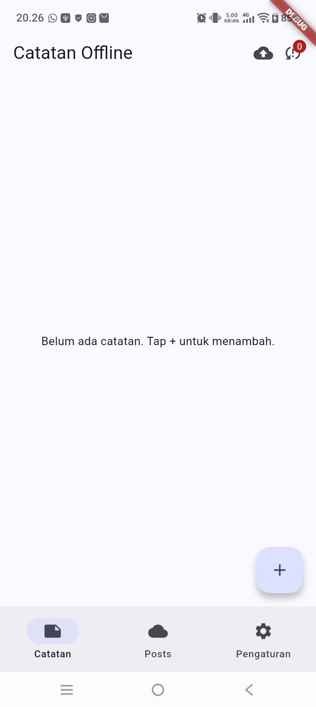
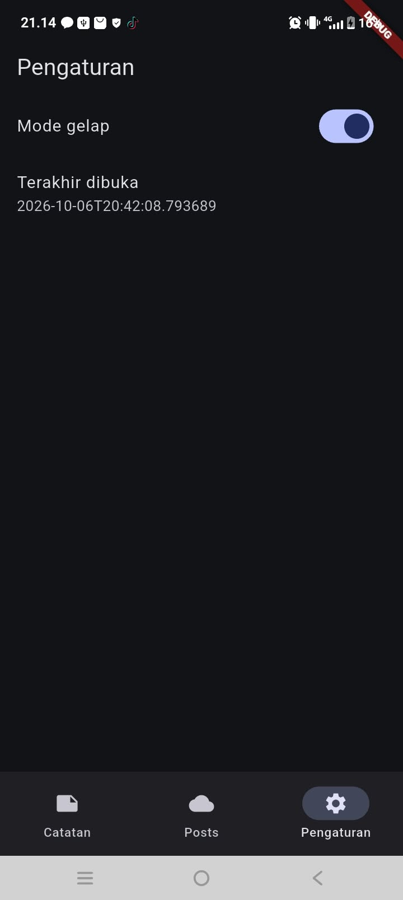
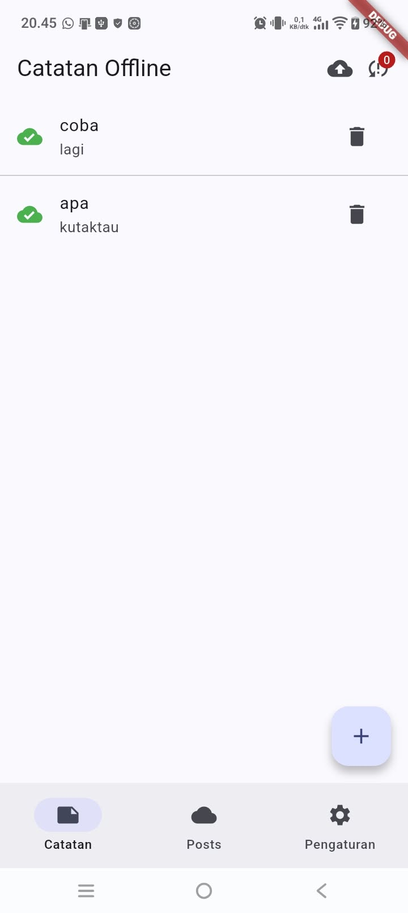
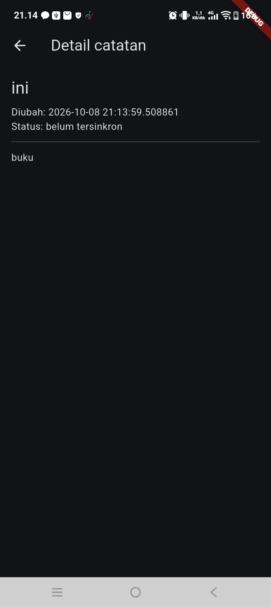
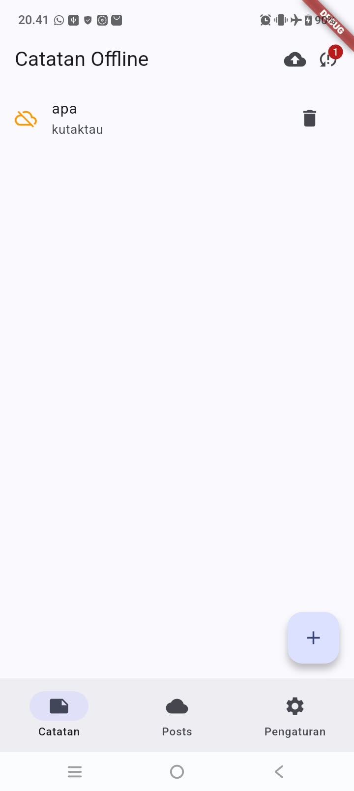
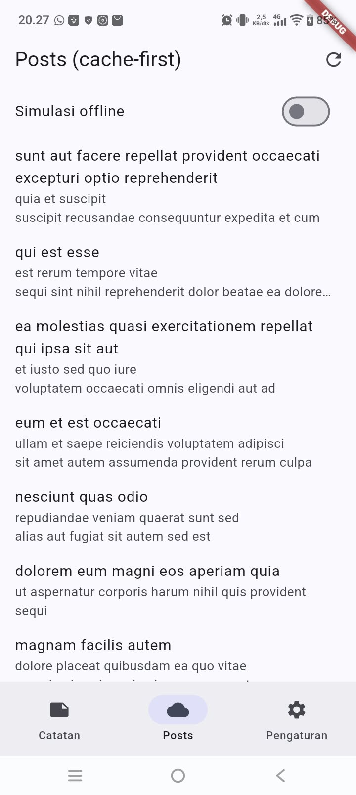
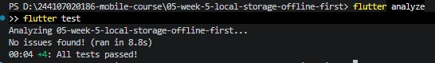

## Tujuan

Membangun aplikasi **Offline Notes** yang tetap bisa dibaca dan ditulis tanpa koneksi internet, lalu disinkronkan saat online. Aplikasi ini mempraktikkan:

- perbedaan penyimpanan key-value, relasional, dan NoSQL di perangkat;
- preferensi sederhana dengan SharedPreferences;
- CRUD catatan dengan SQLite (sqflite) lewat repository lokal;
- pola offline-first: cache-first read, dirty flag, dan antrean sinkronisasi;
- state loading, error, empty, dan success dengan Riverpod;
- pengujian repository lokal memakai repository palsu (tanpa database sungguhan).

## Fitur utama

1. **Preferensi (SharedPreferences):** toggle tema gelap/terang dan waktu terakhir aplikasi dibuka.
2. **CRUD catatan (SQLite/sqflite):** tambah, lihat daftar (diurutkan `updated_at` terbaru), lihat detail, dan hapus catatan.
3. **Badge "belum tersinkron":** setiap catatan baru ditandai `dirty = 1`, dan jumlahnya tampil di AppBar serta pada tiap catatan (`NoteTile`).
4. **Sinkronisasi (simulasi):** tombol sinkron menjalankan `syncNotes`, lalu menandai catatan bersih setelah "server" menjawab sukses.
5. **Cache-first posts:** data `GET /posts` (JSONPlaceholder) ditampilkan dari cache SQLite lebih dulu, lalu diperbarui di latar belakang. Tersedia toggle `forceOffline` untuk demo offline yang deterministik.
6. **Halaman detail** dengan GoRouter (`/note/:id`) yang membaca dari repository lokal.

## Stack teknologi

| Kebutuhan | Paket |
|---|---|
| State management | `flutter_riverpod` |
| Navigasi | `go_router` |
| Preferensi | `shared_preferences` |
| Database lokal | `sqflite`, `path` |
| HTTP | `dio` |

## Hasil yang dicapai

### 1. Preferensi tema dan waktu terakhir dibuka

  

### 2. CRUD catatan

  

### 3. Mode pesawat: aplikasi tetap berfungsi

Daftar catatan tetap tampil, serta tambah dan hapus catatan tetap berjalan saat offline.

  

### 4. Tampilan posts

### 5. Badge dirty sebelum dan sesudah sinkronisasi

| Sebelum sync | Sesudah sync |
|---|---|
|  |  |

### 6. Hasil analisis dan test

Test yang dibuat di `test/note_test.dart`:

1. `fromMap` aman terhadap field yang hilang.
2. Flag `dirty` bertahan pada serialisasi.
3. Provider sukses dengan repository palsu.
4. Provider error dengan repository palsu.

Catatan teknis: pada test error, auto-retry Riverpod 3 membuat future tidak pernah selesai dengan error sehingga test kena timeout. Solusinya mematikan retry di `ProviderContainer` khusus test (`retry: (retryCount, error) => null`).

## Offline-first

- **Cache-first read:** posts dibaca dari tabel `cached_posts` lebih dulu, lalu diperbarui dari jaringan di latar belakang dan disimpan kembali.
- **Dirty flag:** catatan yang belum terkirim ditandai `dirty = 1`.
- **Sinkronisasi:** `syncNotes` memproses catatan dirty dan memanggil `markAllSynced` hanya setelah "server" menjawab sukses (simulasi dengan delay).
- **Aturan konflik:** *last-write-wins* berdasarkan `updated_at` (belum diterapkan karena belum ada backend tulis; sinkronisasi masih simulasi satu arah).

## Refactoring

1. Baris catatan diekstrak menjadi widget `NoteTile` yang menampilkan badge "belum tersinkron".
2. Logika cache posts dan `syncNotes` dipindahkan ke `lib/data/sync.dart` agar repository fokus pada CRUD.
3. Halaman detail catatan memakai GoRouter (`/note/:id`) dan membaca dari repository lokal, bukan dari state halaman list.

## AI Challenge

Dokumentasi lengkap (prompt, output awal AI, tabel perbandingan, hasil verifikasi, dan keputusan final) ada di [`docs/storage-comparison.md`](docs/storage-comparison.md).

**Keputusan:** SharedPreferences untuk preferensi, sqflite (SQLite) untuk catatan.

## Refleksi

**1. Mengapa daftar catatan tidak boleh disimpan di SharedPreferences?**
SharedPreferences hanya untuk nilai primitif kecil. Menyimpan daftar catatan sebagai satu string JSON membuat update parsial harus menulis ulang seluruh daftar, tidak ada query (`WHERE`, `ORDER BY`), performa turun seiring bertambahnya data, dan dirty flag per catatan tidak bisa dibuat sehingga sinkronisasi rapuh.

**2. Kapan cache-first cukup, dan kapan butuh strategi lain?**
Cache-first cukup untuk data yang jarang berubah dan boleh sedikit basi (daftar posts, artikel, katalog). Untuk data yang harus akurat seperti harga real-time, saldo, atau stok, dipakai network-first dengan cache hanya sebagai cadangan saat offline.

**3. Bagaimana dirty flag menjadi antrean sync tanpa memblokir UI? Kapan butuh tabel outbox?**
Perubahan langsung ditulis ke SQLite dengan `dirty = 1`, sehingga UI tidak menunggu server. Sync berjalan asinkron terpisah, dan flag dibersihkan hanya setelah server sukses. Tabel outbox diperlukan bila perlu mencatat jenis operasi (terutama delete, karena baris yang sudah dihapus tidak bisa ditandai dirty), urutan operasi, atau retry per operasi.

**4. Bagian mana dari rekomendasi AI yang ditolak, dan mengapa?**
AI mengusulkan `id TEXT` (UUID) dan kolom `deleted_at` (soft delete). Saya memakai `id INTEGER AUTOINCREMENT` dan `DELETE` langsung sesuai codelab, karena belum ada backend tulis dan sinkronisasi masih simulasi. Konsekuensinya: bila nanti ada server, penghapusan offline tidak akan tersinkron, dan saat itu perlu beralih ke tabel outbox. *(sesuaikan dengan keputusanmu sendiri)*