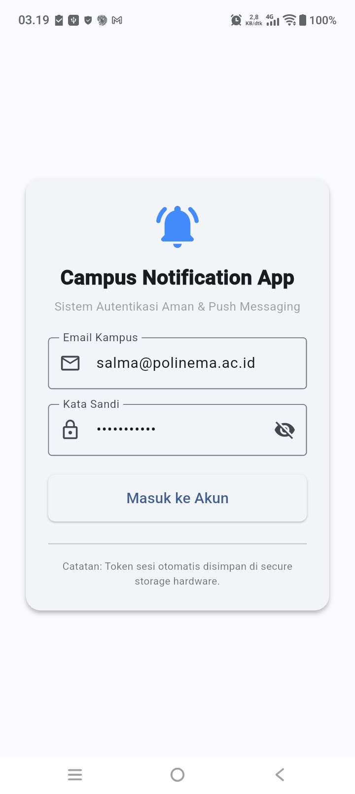
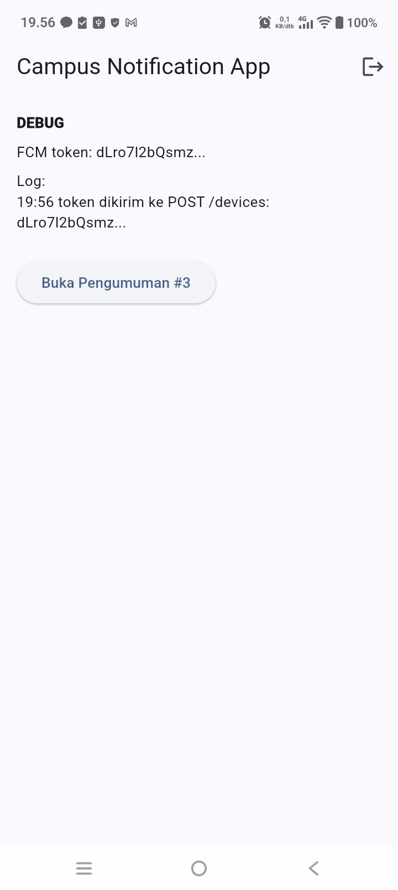
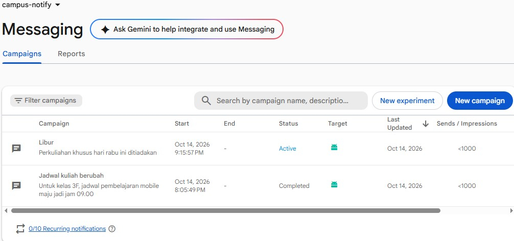
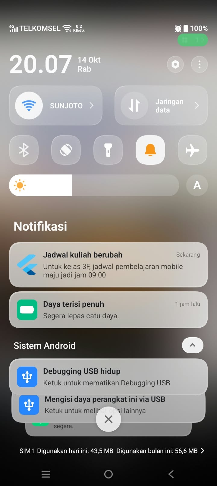
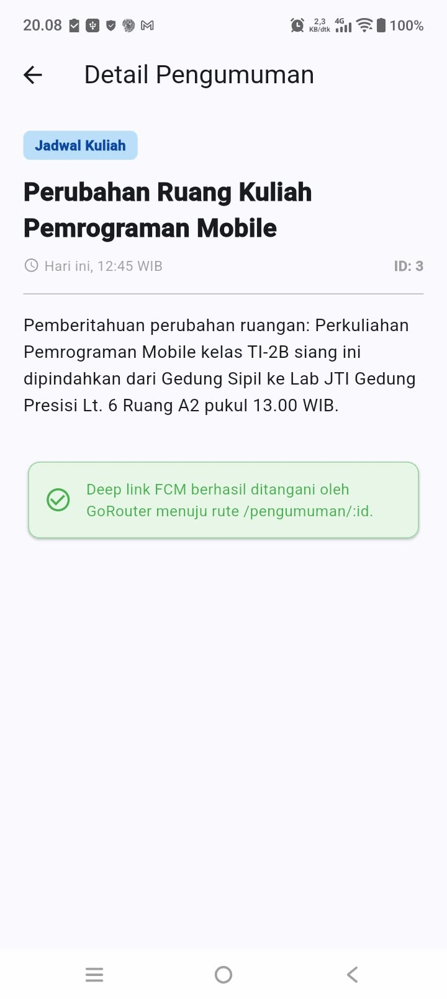
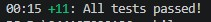

## Tujuan

Membangun aplikasi **Campus Notification App** yang memiliki login dengan penyimpanan token aman, lalu menerima pengumuman kampus lewat Firebase Cloud Messaging (FCM). Aplikasi ini mempraktikkan:

- alur autentikasi berbasis token (access token dan refresh token);
- penyimpanan token aman dengan `flutter_secure_storage` dan refresh otomatis lewat Dio interceptor;
- guard rute dengan GoRouter dan Riverpod;
- FCM: izin notifikasi, token lifecycle (`getToken`, `onTokenRefresh`), dan topic messaging;
- perbedaan notification payload dan data payload pada state foreground, background, dan terminated;
- deep link dari klik notifikasi ke halaman pengumuman.

## Fitur utama

1. **Login (mock):** mock auth provider dengan JWT simulasi, siap diganti Firebase Auth.
2. **Guard rute:** pengguna yang belum login selalu diarahkan ke `/login`.
3. **Token aman:** access dan refresh token disimpan di `flutter_secure_storage`, bukan SharedPreferences.
4. **Refresh otomatis:** saat menerima 401, Dio mencoba refresh satu kali lalu mengulang request; bila refresh gagal, sesi dibersihkan dan kembali ke login.
5. **FCM:** permission, `getToken`, `onTokenRefresh` (dikirim ke `POST /devices`), dan subscribe topik `pengumuman-kampus`.
6. **Notifikasi gabungan `notification + data`:** klik notifikasi membuka `/pengumuman/:id` pada ketiga app state.
7. **Halaman Debug:** menampilkan token FCM terpotong (12 karakter + `...`).

## Stack teknologi

| Kebutuhan | Paket |
|---|---|
| State management | `flutter_riverpod` |
| Navigasi | `go_router` |
| HTTP | `dio` |
| Penyimpanan token | `flutter_secure_storage` |
| Firebase | `firebase_core`, `firebase_messaging` |
| Notifikasi lokal | `flutter_local_notifications` |

## Cara menjalankan

1. Buat project di Firebase Console, daftarkan aplikasi Android dengan package name `com.campus.notify.week_6_authentication_security_fcm`.
2. Unduh `google-services.json` ke `android/app/` (file ini tidak disertakan di repository).
3. Jalankan di perangkat fisik Android:

```
flutter pub get
flutter run -d <id-perangkat>
```

Login dengan email yang mengandung `@` dan kata sandi minimal 6 karakter.

## Hasil yang dicapai

### 1. Login dan guard rute




### 2. Token FCM dan token lifecycle

Token ditampilkan terpotong di halaman Debug. Setelah data aplikasi dihapus / aplikasi di-reinstall, token berubah dan dikirim kembali ke backend lewat `POST /devices` (backend belum tersedia, jadi endpoint didokumentasikan dan pengiriman dicatat di log).

| Sebelum hapus data | Sesudah hapus data |
|---|---|
|  |  |


### 3. Uji kirim dari Firebase Console




### 4. Pengujian tiga app state

Payload: `notification` (title + body) dan `data.route = /pengumuman/3`.



### 5. Hasil analisis dan test



Test yang dibuat di `test/auth_push_test.dart`:

1. `routeFromMessage` menangani route kosong dan tanpa slash.
2. Data payload membawa id pengumuman.
3. Status login dibaca dari keberadaan token.
4. Refresh gagal membuat sesi dibersihkan (paksa login ulang).

## Alur autentikasi dan FCM

- **Token:** `Login` menghasilkan access token (berumur pendek) dan refresh token (berumur panjang), keduanya disimpan di secure storage. Request API membawa `Authorization: Bearer <access>`. Bila 401, refresh token ditukar menjadi access token baru dan request diulang sekali. Bila refresh ikut kedaluwarsa, sesi dibersihkan dan pengguna kembali ke `/login`.
- **FCM:** aplikasi meminta izin notifikasi, mengambil registration token, mengirimkannya ke backend, dan memantau `onTokenRefresh`. Backend mengirim pesan ke token (personal) atau topik (broadcast).
- **Aturan payload:** selalu kirim gabungan `notification + data`. `notification` untuk teks yang dibaca manusia, `data.route` untuk tujuan klik.

## Refactoring

1. Semua string rute dipindahkan ke `lib/routes.dart` agar deep link dari FCM dan GoRouter memakai konstanta yang sama.
2. Logika FCM dipisahkan ke `lib/messaging/push_service.dart` agar `main.dart` hanya merakit aplikasi.
3. Router ditambah `refreshListenable` agar login dan logout langsung memicu redirect.

## AI Challenge

Dokumentasi lengkap (prompt, output awal AI, hasil verifikasi, perbaikan manual, dan keputusan final) ada di [`docs/ai-challenge.md`](docs/ai-challenge.md)

**Keputusan:** `PushService` tidak memegang `BuildContext`; navigasi dikirim lewat callback `router.go`. Pesan broadcast memakai topik, pesan personal memakai token perangkat.

## Refleksi

**1. Refresh token tidak boleh di SharedPreferences karena datanya teks biasa tanpa enkripsi, sehingga bisa dibaca lewat perangkat root, backup, atau malware. flutter_secure_storage memakai Keychain/Keystore yang terenkripsi. Bila bocor, penyerang bisa menerbitkan access token baru dan menyamar sebagai pengguna tanpa kata sandi, sampai token dicabut atau kedaluwarsa.
**2. Bila onTokenRefresh diabaikan, backend menyimpan token FCM basi (setelah reinstall, hapus data, atau rotasi keamanan). Notifikasi personal tidak sampai walau server mencatat sukses, dan token basi menumpuk di database.
**3. Topik untuk broadcast tanpa mengelola daftar token, misalnya “Kelas Mobile pindah ke Ruang A2” ke pengumuman-kampus. Token perangkat untuk pesan personal, misalnya “Nilai UTS Mobile Anda sudah keluar” atau “Tagihan UKT jatuh tempo”.
**4. Bagian draf AI yang diperbaiki:
initialize dan show memakai bentuk posisional dan gagal compile; diganti parameter bernama (settings:, id:, title:, dst.).
Core library desugaring tidak disebut, sehingga build gagal sampai diaktifkan di android/app/build.gradle.kts.
Plugin google-services dan google-services.json tidak disebut; tanpanya Firebase tidak terinisialisasi dan token tidak terambil.
main() hilang dari main.dart sehingga layar putih; dipisahkan dari push_service.dart.
Pengiriman token ke POST /devices tidak bisa dibuktikan karena backend tidak ada; ditulis sebagai endpoint yang didokumentasikan, bukan dianggap berhasil.