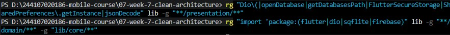
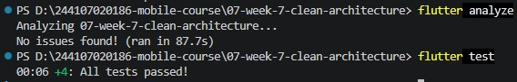

## Cara menjalankan

1. Siapkan `google-services.json` di `android/app/` (tidak disertakan di repository), sama seperti Minggu 6.
2. Jalankan di perangkat fisik Android:

```
flutter pub get
flutter run -d <id-perangkat>
```

3. Login dengan email yang mengandung `@` dan kata sandi minimal 6 karakter.
4. Jalankan pemeriksaan:

```
flutter analyze
flutter test
```

## Hasil yang dicapai

### 1. Audit layer project lama

| File | Layer saat ini | Masalah |
|---|---|---|
| `lib/pages/home_page.dart` | presentation | Memanggil `PushService` (Firebase) langsung di `initState`; logika masking token ada di widget |
| `lib/pages/login_page.dart` | presentation | OK, hanya memanggil notifier Riverpod |
| `lib/pages/announcement_page.dart` | presentation | Logika bisnis (`_getAnnouncementData`) ada di widget; data statis seharusnya di repository |
| `lib/data/api_client.dart` | data | OK, hanya dipakai repository |
| `lib/data/auth_repository.dart` | data | Interface dan implementasi dalam satu kelas, tidak ada abstraksi |
| `lib/data/token_store.dart` | data | OK, diakses lewat provider |
| `lib/data/api_errors.dart` | data | Bisa dipindah ke `core/` sebagai failure |
| `lib/providers/auth_provider.dart` | presentation (state) | OK, hanya memanggil repository |
| `lib/messaging/push_service.dart` | infra | OK, dipakai di `main.dart`, bukan di widget |
| `lib/messaging/route_from_message.dart` | domain (pure Dart) | Sudah baik, tanpa dependensi Firebase |

Tiga pelanggaran yang ditemukan:

```
# Widget menyentuh Firebase langsung
pages/home_page.dart → PushService.initFcmToken(...)

# Logika bisnis di dalam build()
pages/announcement_page.dart → _getAnnouncementData()

# Interface dan implementasi tercampur
data/auth_repository.dart → class AuthRepository { ... }
```

Diagram dependensi sebelum refactor:

```
LoginPage        ──→ authStateProvider ──→ AuthRepository (konkret)
HomePage         ──→ PushService (Firebase langsung)             ← pelanggaran
AnnouncementPage ──→ _getAnnouncementData() (logika di widget)   ← pelanggaran
```

### 2. Pemeriksaan sterilitas layer

<!-- ISI: tempel perintah rg dan outputnya dari terminal. Target: nol hasil di presentation dan domain. -->

| Pemeriksaan | Folder | Hasil |
|---|---|---|
| Widget menyentuh Dio / database / storage langsung | `presentation` | _isi: 0 hasil_ |
| Logika bisnis (`jsonDecode`, format tanggal) di `build()` | `presentation` | _isi: 0 hasil_ |
| Instansiasi manual repository / Dio | `presentation` | _isi: 0 hasil_ |
| Import Flutter / Dio / SQLite / Firebase | `domain` | _isi: 0 hasil_ |

### 3. Implementasi per layer

**Domain.** Entity `AuthSession` hanya menyimpan `access` dan `refresh`, tanpa `toJson`. Kontrak `AuthRepository` dan `AnnouncementRepository` dipisah (interface segregation). Use case: `LoginUseCase`, `LogoutUseCase`, `GetAnnouncementUseCase`.

**Data.** `AuthSessionModel extends AuthSession` menambahkan `fromJson/toJson`. `AuthRepositoryImpl` memakai `FlutterSecureStorage`; `AnnouncementRepositoryImpl` menampung data pengumuman yang sebelumnya ada di widget.

**Presentation.** Dependensi disuntik lewat Riverpod:

```dart
final authRepositoryProvider = Provider<AuthRepository>((_) => AuthRepositoryImpl());

final loginUseCaseProvider = Provider<LoginUseCase>(
  (ref) => LoginUseCase(ref.watch(authRepositoryProvider)),
);

final announcementProvider = FutureProvider.family<Announcement, String>((ref, id) {
  return ref.watch(getAnnouncementUseCaseProvider)(id);
});
```

`AnnouncementPage` sekarang hanya `ref.watch(announcementProvider(id))` lalu menampilkan `loading`, `error`, atau `data`.

### 5. Screenshot before/after

| Fitur | Sebelum refactor | Sesudah refactor |
|---|---|---|
| Login |  |  |
| Pengumuman |  |  |

### 6. Hasil analyze dan test



Empat test, semuanya memakai repository palsu tanpa Firebase, Dio, atau storage:

| File | Kasus |
|---|---|
| `test/login_use_case_test.dart` | Mengembalikan `AuthSession` saat kredensial valid |
| | Melempar exception saat email tanpa `@` |
| | Melempar exception saat kata sandi kurang dari 6 karakter |
| `test/announcement_use_case_test.dart` | Mengembalikan `Announcement` dengan id yang benar |

## Keputusan arsitektur

- **Feature-first** dipilih karena project sudah punya lebih dari satu fitur (auth, announcements, home/FCM), sehingga tiap fitur bisa dipahami atau dihapus tanpa menyentuh fitur lain.
- **`messaging/` tetap di luar `features/`** karena merupakan infrastruktur lintas fitur, bukan milik satu fitur.
- **`FutureProvider.family`** untuk pengumuman supaya hasil tiap id di-cache terpisah oleh Riverpod.
- **Tanpa dependency baru:** refactor hanya reorganisasi kode dan pemisahan abstraksi.

## AI Challenge

Dokumentasi lengkap (prompt, output awal AI, tabel usulan AI vs keputusan final, dan hasil pemeriksaan) ada di [`docs/ai-challenge.md`](docs/ai-challenge.md).

## Refleksi

**1. Mengapa interface repository harus berada di domain, dan apa yang rusak jika dipindahkan ke data?**
Domain yang mendefinisikan kontrak, data yang mengikutinya (dependency inversion). Kalau interface ada di data, domain harus mengimpor data sehingga panah dependensi berbalik dan domain ikut terseret Dio, storage, atau Firebase. Use case jadi tidak bisa diuji tanpa dependensi itu.

**2. Kapan use case benar-benar diperlukan, dan kapan repository langsung ke notifier sudah cukup?**
Use case perlu saat ada aturan bisnis yang layak diuji sendiri atau dipakai di banyak tempat. Untuk operasi satu baris yang hanya meneruskan panggilan, seperti `LogoutUseCase` dan `GetAnnouncementUseCase` di project ini, repository langsung ke notifier sudah cukup.

**3. Apa biaya over-engineering bagi tim kecil, dan kapan biayanya sepadan?**
File naik dari 9 menjadi 27, setup lebih lama, dan anggota baru harus memahami strukturnya dulu. Untuk 2–3 fitur seperti `campus_notify` ini berlebihan. Biayanya sepadan saat fitur bertambah atau logika bisnis perlu diuji otomatis.

**4. Bagian mana dari usulan AI yang ditolak atau disederhanakan, dan mengapa?**
Saya menolak sebagian saran AI untuk menghindari use case satu baris: `LogoutUseCase` dan `GetAnnouncementUseCase` tetap saya buat agar pola tiap fitur seragam dan mudah dipelajari, meski di project nyata keduanya cukup diganti repository langsung. Saya juga menyederhanakan saran `Failure`: kelas `sealed Failure` sudah dibuat di `core/`, tetapi repository masih melempar `Exception` dan pemetaannya belum diterapkan. Saran lain saya terima, yaitu struktur feature-first, pemisahan interface dan implementasi repository, serta DI lewat Riverpod tanpa package tambahan.